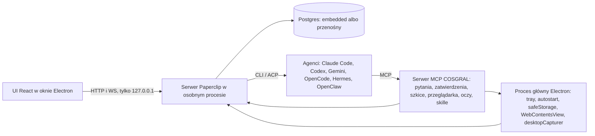

# Decyzja: silnik i kierunek wizualny COSGRAL Workspace (12.11.2026)

**Status:** przyjęta przez lidera (Okiestrator).
**Powód:** właściciel napisał, że jeśli silnik taki jak w OpenBocie jest lepszy i bardziej pasuje, mamy go wziąć pod uwagę. Produkt ma być lepszy niż OpenBot, również wizualnie. Wybór należy do zespołu.

## 1. Decyzja w trzech zdaniach

1. **Silnik sterujący zostaje: Paperclip** (nasz fork, licencja MIT). Odpowiada za agentów, zadania, kanały, zatwierdzenia, rutyny, sekrety, skille, koszty i adaptery.
2. **Warstwę uruchomieniową budujemy na wzór architektury OpenBota, własnym kodem.** Electron zarządza procesami. Agenci działają przez CLI i ACP na subskrypcjach. Aplikacja jest serwerem MCP dla agentów. Przeglądarka agenta to `WebContentsView`, a sekrety trzymamy w `safeStorage`.
3. **Hermes Agent, OpenClaw i inni agenci ACP są dodatkowymi silnikami agentów w środku**, nie zamiennikiem platformy. Adaptery do nich już są w repo.

## 2. Porównane opcje

| Kryterium | A. Paperclip + warstwa w stylu OpenBota | B. Własny silnik od zera (Electron + SQLite + ACP) | C. Silnik OpenBota |
|---|---|---|---|
| Licencja pozwala na użytek firmy | ✓ | ✓ | — |
| Kod źródłowy do rozwijania | ✓ | ✓ | — |
| Gotowi agenci, zadania, zatwierdzenia, rutyny, sekrety, skille | ✓ | — | ✓ |
| Gotowe adaptery do wielu CLI agentów | ✓ | — | ✓ |
| Lekki runtime bez osobnej bazy danych | — | ✓ | ✓ |
| Autorzy testują serwer na Windows | — | — | ✓ |
| Poprawki od upstream za darmo | ✓ | — | — |
| MVP w tygodniach, nie w miesiącach | ✓ | — | — |

**Wybór: A.** Ma najwięcej plusów. Jego dwa minusy (Windows i ciężar bazy) zamyka bramka G1 i plan awaryjny z §4.

### Dlaczego nie silnik OpenBota (C)

- Licencja PolyForm Noncommercial 1.0.0 zabrania użytku komercyjnego, a COSGRAL to firma.
- Nie ma kodu źródłowego, tylko zminifikowana paczka (`out/main/index.js`, około 30 MB). Rozwijanie tego byłoby kopiowaniem i nie dałoby się tego utrzymać.
- **Bierzemy z niego pomysły, nie kod:**
  - serwer w osobnym procesie,
  - ACP jako wspólny protokół agentów,
  - aplikacja jako serwer MCP dla agentów,
  - przeglądarka w `WebContentsView` z przejęciem,
  - stany „czeka na ciebie” widoczne wszędzie.

  Źródło: `docs/cosgral-raporty/claude-k-openbot-ux-map.md` §1.

### Dlaczego nie własny silnik od zera (B)

- Fork Paperclip ma 8604 pliki TS w `server/`, `ui/` i `packages/`.
- Ma 12 katalogów adapterów: Claude, Codex, Cursor (lokalny i chmurowy), Gemini, Grok, Hermes (CLI i gateway), Kimi, OpenClaw, OpenCode i Pi. Claude i Codex mają już ścieżkę ACP (`packages/adapters/*/src/server/acp.ts`).
- Do tego dochodzą serwer MCP (`packages/mcp-server`), SDK pluginów, katalog skilli i zatwierdzenia.
- Odtworzenie tego od zera zajęłoby miesiące, zanim w ogóle dogonilibyśmy obecny stan.
- Upstream jest aktywny i ma licencję MIT. Jedna recenzja z czerwca 2026 podaje około 71 tys. gwiazdek, ale tej liczby nie sprawdziliśmy.

### Hermes, OpenClaw, Goose jako baza (odrzucone jako platforma)

- To pojedynczy osobiści asystenci lub agenci kodujący. Brakuje w nich wspólnego modelu zadań, kanałów z liderem i zatwierdzeń dla zespołu ludzi i agentów.
- Wnoszą wartość jako **agenci uruchamiani przez Paperclip**: Hermes ma pętlę uczenia się skilli, która pasuje do Plugin Studio, a OpenClaw ma bramki komunikatorów.
- Goose przez ACP do sprawdzenia w F2, bez zobowiązań.

## 3. Architektura docelowa

- **Karty akcji w czacie mają jeden kontrakt dla wszystkich agentów.** Agent wywołuje narzędzie MCP COSGRAL (pytanie, zatwierdzenie, szkic, przejęcie przeglądarki). Serwer zapisuje je jako interakcję lub zatwierdzenie Paperclip, a UI rysuje kartę. Nie zależy to od dostawcy modelu.
- **Oczy agenta:** `desktopCapturer` w procesie głównym, a dla agenta narzędzie MCP „zrzut / podgląd”. Zawsze ze zgodą człowieka i z widocznym wskaźnikiem.
- **Przeglądarka agenta:** lokalny `WebContentsView` z CDP, a nie chmurowy connector browser-use. Ten zostaje opcjonalny.

## 4. Ryzyka Paperclip i jak je zamykamy

| Ryzyko | Dowód | Co robimy |
|---|---|---|
| Serwer nie jest testowany na Windows | W `.github/workflows` na Windows testowany jest tylko natywny Runner w Rust (`runner-windows.yml`). Wydania mają cele linux i darwin (`release-verify.yml`). | Bramka G1 poniżej. Testy na Windows dopisujemy do naszych E2E. |
| `embedded-postgres` 18 beta na Windows | Wcześniej startował tylko ręcznie (`pg_ctl`) według `COSGRAL-AUDYT.md`. | Plan awaryjny: przenośny PostgreSQL dla Windows jako proces potomny Electrona plus `DATABASE_URL`, bo Paperclip obsługuje zewnętrzny Postgres. PGlite odpada, bo Paperclip już od niego odszedł (zostało tylko przeniesienie starej konfiguracji w `cli/src/config/store.ts`). |
| Skrypty buildu w składni bash | `mkdir -p` i `cp -R` w buildzie serwera | `sh.exe` z MinGit jako `script-shell` dla pnpm (Backend to sprawdza) albo przepisanie na Node. |
| Język „firmy” (CEO, rekrutacja, budżety, chmura) | Model Paperclip | W powłoce UI ukrywamy go za flagami i zmieniamy słownik na przestrzeń, projekt, agent, kanał. Kod zostaje, żeby łatwo scalać upstream. |
| Rozjazd z upstream | Duży fork | Nasze zmiany trzymamy w wydzielonych modułach `cosgral`, a w plikach upstream zmieniamy jak najmniej. |

### Bramka G1 (koniec F1, właściciel: Backend Expert, sprawdza: Tester)

1. Czysty start od zera na tym PC: okno Electron i `/api/health` 200.
2. Trzy restarty aplikacji z rzędu bez ręcznego `pg_ctl`.
3. Jedno pełne uruchomienie agenta na Windows (`claude_local` albo `codex_local`) z wynikiem w czacie.
4. Zmierzony czas zimnego startu.

Jeśli G1 nie przejdzie po około dwóch dniach pracy, przechodzimy na plan awaryjny bazy i robimy ponowną ocenę. Wtedy dopiero wraca opcja B, i to tylko dla warstwy danych.

## 5. Wygląd: jak udowodnimy „lepiej niż OpenBot”

- Źródłem prawdy jest `DESIGN.md` i tokeny w `ui/src/index.css`. Bez drugiego systemu kolorów (OLED hex z `cosgral-shell-motion.css` idzie do migracji albo do usunięcia, krok F2.11).
- **F2.0 (nowy krok przed kodem powłoki):** kierunek wizualny plus 3 ekrany w trybie jasnym i ciemnym:
  - pasek boczny ze stanami,
  - czat z kartą pytania,
  - kanał z zadaniami.

  Porównanie obok zrzutów OpenBota oceniane krytyką impeccable. Zrzuty OpenBota trzymamy poza repo ze względu na licencję.
- **Kryteria akceptacji wyglądu:**
  - stan „czeka na ciebie” widać w ciągu 1 sekundy z każdego ekranu,
  - interfejs jest najpierw po polsku (paczka `pl` w `ui/src/i18n/cosgral.ts`),
  - jasny i ciemny motyw przechodzą `pnpm check:token-gates`,
  - żadnego świecenia, sztucznych danych ani ozdobników bez informacji.

## 6. Akceptacja shape UI (`doc/plans/2026-11-12-ui-shell-shape.md`, commit `a23701a87`)

Wszystkie 3 decyzje i założenia A1–A3 są zaakceptowane. Poprawki:

1. **Decyzja 1, Chat-first, Canvas nie wchodzi:** zaakceptowana.
2. **Decyzja 2, kanały = `ProjectConversation` + `CoordinatorTasks` + `Issues`:** zaakceptowana.
3. **Decyzja 3, karty w czacie = UX zatwierdzeń:** zaakceptowana. Źródłem kart jest serwer MCP COSGRAL z §3, wspólny dla wszystkich agentów.
4. **Dodać F2.0** z §5 przed F2.1.
5. **Słownik powłoki:** nie używamy w nawigacji słów „company”, „CEO”, „hiring”.
6. **Chip stanu „nowa odpowiedź”** (nieprzeczytana) obok Thinking, Waiting on you, Limit, Error i Idle.
7. **Przed F2.1 sprawdzić istniejący przełącznik Chat / Tabela / Workflow** (etykiety `work.views` w `ui/src/i18n/cosgral.ts`) i użyć go ponownie, zamiast budować drugi raz.
8. **F2.10 (obecność na żywo)** zależy od zdarzeń WS od Backendu. Kontrakt trzeba uzgodnić z Backend Expertem przed kodem.

## 7. Czego nie sprawdziłem

- Nie uruchamiałem jeszcze serwera Paperclip na Windows. To jest zadanie F1 Backendu i bramka G1.
- Nie sprawdziłem, czy Goose obsługuje ACP. Liczba gwiazdek Paperclip pochodzi z recenzji zewnętrznej.
- Nie obejrzałem na żywo pikseli OpenBota 0.68.0. To zakres F2.0 i Testera.
