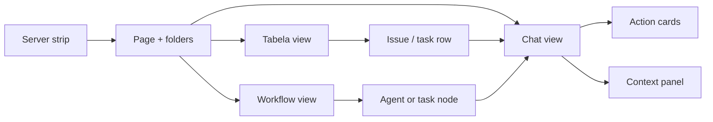

# OpenBot+ shell shape — F1 (12.11.2026)

**Status:** waiting for leader acceptance · **No `ui/src` code in this commit**  
**Author:** UI Designer · branch `team/ui/p1-shell-shape`  
**Skills:** impeccable `shape` + Canvas `critique` · superpowers brainstorming  
**Sources:** `DESIGN.md`, `doc/plans/2026-11-12-cosgral-openbot-plus.md`, `docs/cosgral-raporty/claude-k-openbot-ux-map.md`, `COSGRAL-PROMPT-POSTEP.md` §3/§8/§9, `docs/cosgral/referencja-interfejsu.png`, `Layout.tsx`, `MultiAgentCanvas.tsx`, `cosgral-shell-motion.css`  
**License note:** OpenBot PolyForm Noncommercial — behavior only; no copy of texts, graphics, icons, names, or branding.

---

## 0. Brief (shape)

| Field | Decision |
|---|---|
| **Job** | Operator shell for COSGRAL Workspace: scan agent/channel state, chat, approve, watch eyes, build plugins. |
| **Audience** | 2 operators (same project, live) + agents. Mode: **Operate**. |
| **Primary outcome** | In one glance: *what is happening → does it need me → what do I do*. |
| **Product truth** | Slack × Codex × Linear density; Paperclip engine under the hood; calmer and clearer than OpenBot. |
| **Anti-goals** | Glowing dashboards, AI-slop cards, parallel design systems, OpenBot clone of copy/brand, Canvas as home screen. |
| **Visual authority** | Existing `DESIGN.md` + semantic tokens in `ui/src/index.css`. Brand hex TBD → only tokens. |
| **Assumptions (mark for leader)** | (A1) Server rail is secondary to company/project for MVP. (A2) Chat/Tabela/Workflow share one data model (issues + conversation). (A3) Plugin Studio expands `SkillStudio`, not a greenfield app. |

---

## 1. Shell topology (ASCII)

```
┌────┬──────────────┬────────────────────────────┬──────────────────┐
│ SR │ Page rail    │ Main: Chat | Tabela | Flow │ Context panel    │
│    │ / Agents     │                            │ (files · agent · │
│    │ / Channels   │  messages + action cards  │  eyes · subagents│
│    │   + status   │                            │  · presence)     │
│    │              │  composer                  │                  │
└────┴──────────────┴────────────────────────────┴──────────────────┘
  SR = server / instance strip (narrow; optional on single-PC MVP)
```



---

## 2. Screen map

For each screen: **goal · states · keyboard/mouse · light/dark · where in `ui/`**.

### 2.1 Server + page rail

| | |
|---|---|
| **Goal** | Switch instance/server and top-level product surfaces without losing the conversation context when possible. |
| **States** | empty (no company) · loading companies · error (health/API) · single-server (strip collapsed/hidden) · multi-server. |
| **Input** | Click rail; `Cmd/Ctrl+K` command palette; `1–9` optional page jump later. |
| **Theme** | Semantic `--sidebar-*`; no glow. Light = same structure, higher surface contrast. |
| **Embed** | Reuse `Layout.tsx` + `Sidebar.tsx` / `SidebarShell` / `CompanySettingsNav`. New: thin **server strip** only if Backend exposes multi-instance; until then hide strip, keep company switcher. Pages map to existing routes in `company-routes.ts` (`agents`, `inbox`, `issues`/`tasks`, `routines`, `costs`/`usage`, `skills`, `settings`, `board-chat`, `projects`). |

**Page rail (MVP labels — own copy, not OpenBot):** Agents · Inbox · Tasks · Routines · Skills · Costs · Settings. Pin order later.

---

### 2.2 Agent + channel sidebar (folders + status)

| | |
|---|---|
| **Goal** | Find a person, agent, or channel; see who needs the human **before** opening chat. |
| **States** | empty folder · loading list · error · agent: idle / thinking / waiting-on-you / waiting-limit / error · channel: unread / task-in-flight / stopped. |
| **Input** | Click row; drag reorder folders (F2+); context menu (edit, new thread, mark read); filter typing in list. |
| **Theme** | Status via `--status-agent-*` only (DESIGN.md §5). Pulse only for *waiting-on-you* if motion allowed; respect `prefers-reduced-motion`. |
| **Embed** | Extend `SidebarAgents` + `AgentConversationsSidebar`. Channels = new list model on **ProjectConversation / BoardChat / CoordinatorTasks** (not a parallel nav). Folder UI can borrow `SidebarProjects` patterns. |

**Status chip vocabulary (one system everywhere):**

| Chip | Means | Operator action |
|---|---|---|
| Thinking | Agent run active | Optional: open chat / cancel |
| Waiting on you | Question, approval, or browser takeover | Open chat → card |
| Limit | Provider quota / reset time | Wait or switch model |
| Error | Failed run | Open chat → retry / fix |
| Idle | Quiet | Start message |

---

### 2.3 Main chat + action cards

| | |
|---|---|
| **Goal** | Chronological work log that stays readable; decisions happen **in-thread**. |
| **States** | empty thread · loading history · streaming · error inline · waiting on card · composer queued. |
| **Cards** | (1) Question 1–3 options · (2) Confirm with draft preview · (3) Permission/approval · (4) Browser takeover. |
| **Input** | Enter send · Shift+Enter newline · `@` agent · attach · Up edit last own · focus card with Tab · `1–3` answer focused question. |
| **Theme** | Human right / others left already in DESIGN.md. Cards: one surface, hairline border, no gradient progress bars as hero (referencja shows progress — keep **compact**, token-colored bar only). |
| **Embed** | `AgentChat`, `ProjectConversation`, `BoardChat`, issue chat paths. Approvals today: `Approvals` / `ApprovalDetail` / `WhatNeedsMe` — **surface the same payloads as in-chat cards**, keep list pages as Inbox/audit. Composer + queue: reuse existing agent chat queue patterns from DESIGN.md. |

**Card layout (ASCII):**

```
┌─ Needs you ─────────────────────────┐
│ Short question / draft preview      │
│ [ Option A ] [ Option B ] [ Other ] │
│ or  Allow · Always · Deny           │
└─────────────────────────────────────┘
```

---

### 2.4 Context panel (right)

| | |
|---|---|
| **Goal** | Inspect files, agent settings, eyes stream, subagents — without leaving chat. |
| **States** | collapsed (default) · open tab · loading · error · eyes: off / requesting consent / live / blocked · empty files. |
| **Tabs (MVP)** | Files · Agent · Eyes · Subagents. Presence strip sits above tabs when ≥2 humans online. |
| **Input** | `]` toggle panel · resize handle · Escape closes takeover overlay only. |
| **Theme** | Same as `PropertiesPanel` / contextual sidebars; eyes preview is a quiet video surface + **“Agent looking”** badge (see §4). |
| **Embed** | `PropertiesPanel`, `AgentContextualSidebar`, `SecondarySidebar`, `ContextualSidebarFrame`. Files: Artifacts / workspace file UIs already in repo. Subagents: run/child task lists from coordinator/issue detail. Eyes: **new** Electron-backed pane (F3), stub tab in F2 with “not connected”. |

---

### 2.5 Channel with leader + tasks

| | |
|---|---|
| **Goal** | Slack-like room: humans + agents; human message → owned task → result in same history. |
| **States** | empty channel · loading · error · no leader · tasks running / blocked / stopped (reassign). |
| **Input** | Same composer; channel settings (instructions, memory isolation, routines) in panel or modal. |
| **Theme** | Channel header = name + leader chip + presence; no neon “MESH LIVE”. |
| **Embed** | **Primary:** `ProjectConversation` + `CoordinatorTasks` + `Issues` / issue detail. Channel settings can mirror `RoutineContextualSidebar` patterns. Do not invent a second task engine. |

---

### 2.6 Three views of the same work (Chat / Tabela / Workflow)

| View | Goal | States | Input | Embed |
|---|---|---|---|---|
| **Chat** | Default narrative | as §2.3 | view toggle `Ctrl+\` or header segmented control | Project/Board/Agent chat |
| **Tabela** | Scan/filter tasks | empty · loading · error · filtered-zero | sort/filter; Enter opens chat at task | `Issues` / `IssuesList` / `MyIssues` / `CoordinatorTasks` |
| **Workflow** | See who blocks whom | empty DAG · loading · error · stale | click node → chat/agent; pan/zoom later | **New thin view** fed by same issue graph — **not** shipping `MultiAgentCanvas` as-is (see §5) |

Switching views **must not** remount composer or lose scroll anchor of the selected task.

---

### 2.7 Plugin Studio (surface, F4-heavy)

| | |
|---|---|
| **Goal** | Agent proposes skill/MCP → sandbox test → human approve → catalog. |
| **States** | draft · testing · failed test · awaiting approval · published · error. |
| **Embed** | Expand `SkillStudio` + `CompanySkills` + approvals card in chat. Marketplace later. |

---

## 3. Light / dark

- Keep shadcn semantic pairs in `index.css` (already light/dark).
- **Do not** introduce OLED-only hex stack from `cosgral-shell-motion.css` (`--bg-base: #090A0F`, glow utilities) as a second system. F2: either delete parallel tokens or migrate values into `index.css` as optional theme, then gate with token-gates.
- Status colors: only `--status-*` / semantic destructive/warning.
- Motion: keep page-enter / agent-live ideas from `cosgral-shell-motion.css` **after** they consume design tokens (no raw `#6ea8ff`).

---

## 4. Differentiators vs OpenBot (UX, own branding)

| Differentiator | UX contract |
|---|---|
| **Live shared session** | Presence avatars in channel header + panel; typing indicators; optional cursors on Tabela/Workflow; **Observe mode** follows peer’s section/clicks without forcing nav for others. |
| **Agent looking (eyes)** | Persistent badge on agent row + panel tab when capture is live; consent gate before first share; pause/stop always one click; never silent capture. |
| **Plugin Studio** | Creation flow visible as chat cards + Studio page; approval is first-class, same card system as permissions. |
| **Calm premium** | Density from information (DESIGN.md), not chrome; reference mock (`referencja-interfejsu.png`) for hierarchy (sidebar → chat → compact status cards), **not** for teal glow / generic “WorkHub” brand. |

---

## 5. Critique: `MultiAgentCanvas.tsx`

**Verdict: keep as discarded prototype / idea scrapbook; do not ship; do not mount in `Layout`. Rebuild Workflow later as a thin, tokenized view on real issue edges.**

### Why

1. **Orphan:** only self-references; not on any route — good that it cannot leak into product yet.
2. **Token violation:** dozens of hardcoded hex (`bg-[#090A0F]`, borders, pills). Conflicts with DESIGN.md principle 2 and `pnpm check:token-gates`.
3. **AI-slop / anti-brief:** “MESH LIVE”, pulse badges, glow classes (`cosgral-node-glow-*`), emoji avatars, autonomy %, fake telemetry — opposite of “spokojnie, premium, bez świecących dashboardów”.
4. **Fake world:** hardcoded agents (Gremlinek, Geminek…), invented FPS/WebRTC claims — teaches wrong IA.
5. **Competes with shell:** full-screen own header + 3-pane layout duplicates `Layout` / sidebars instead of plugging into Chat|Tabela|Workflow toggle.
6. **Naming risk:** “Grok-Eyes HUD” leans on third-party brand; product copy should say **Eyes** / **Agent looking**.
7. **Useful scraps to salvage:** status enum (`thinking | waiting | quota_limit | idle`), idea of DAG vs matrix toggle, succession as a *backend* concept — express later in Tabela columns and Workflow nodes, not this component.

### Critique scores (Operate mode · source review · no live browser)

⚠️ DEGRADED: single-context (Canvas not routed; app not running in this task; detector not used as gate for a non-shipping file).

| Heuristic (0–4) | Score | Note |
|---|---|---|
| Visibility of system status | 2 | Loud but fake |
| Match real world | 1 | Demo names, not Paperclip |
| User control | 2 | Succession button unclear |
| Consistency | 0 | Parallel visual system |
| Error prevention | 1 | No real errors |
| Recognition vs recall | 2 | Crowded chrome |
| Flexibility | 1 | View modes without data |
| Aesthetic minimalism | 0 | Slop |
| Help recover errors | 1 | — |
| Help/docs | n/a | Prototype |

**Priority issues:** (1) dual token system with `cosgral-shell-motion.css` · (2) would train operators on fake status · (3) blocks calm Chat-first IA if ever mounted as home.

**Recommendation for F2:** leave file unmounted or move under `ui/src/labs/` in a later cleanup commit after acceptance; Workflow ships as new component wired to issues API.

Questions skipped: leader acceptance of this shape replaces critique follow-up questions.

---

## 6. F2 implementation order (small steps + acceptance)

Each step: one PR-sized change, tokens only, no OpenBot assets.

| # | Step | Acceptance |
|---|---|---|
| **F2.1** | Shell IA: Chat \| Tabela \| Workflow toggle on project/channel routes; default Chat; remember last view per project in local prefs | Toggle switches views without remounting composer; URL or query reflects view; light+dark smoke |
| **F2.2** | Agent/channel row status chips (`thinking`, `waiting-on-you`, `limit`, `error`, `idle`) on `SidebarAgents` + conversation list | Waiting-on-you appears when open approval/question exists; chip uses status tokens; reduced-motion OK |
| **F2.3** | In-chat **Question** card (1–3 options) bound to existing ask/approval payloads | Answering from card resolves the wait; keyboard `1–3` works when focused; empty/error states copy is actionable |
| **F2.4** | In-chat **Confirm / draft preview** card | Preview matches outbound draft; Send / Edit / Keep actions; decline leaves draft |
| **F2.5** | In-chat **Permission** card wired to Approvals | Allow / Always / Deny updates Approvals list; WhatNeedsMe count matches |
| **F2.6** | Channel header: leader chip + task summary + link to Tabela filtered to channel | Two browsers see same task states after refresh (live sync can land with Backend) |
| **F2.7** | Context panel tabs: Files + Agent (reuse) · Eyes stub · Subagents list | Collapse default; `]` toggles; Eyes stub explains F3 |
| **F2.8** | Tabela = Issues list as alternate view of same channel/project work | Row click focuses chat message/task; filters persist per view |
| **F2.9** | Workflow v0: read-only graph of coordinator + child tasks (new component, tokens) | Node click → same target as Tabela; empty/loading/error; **MultiAgentCanvas not imported** |
| **F2.10** | Live presence strip (avatars + typing); Observe mode behind flag | Second user visible when Backend events exist; Observe opt-in only |
| **F2.11** | Retire parallel OLED hex in shell CSS into `index.css` or delete unused | `pnpm check:token-gates` clean for touched files |

**Out of F2 (track in plan):** Eyes live capture (F3), Plugin Studio publish flow (F4), Vault, Mobile Connect, dock/island.

---

## 7. Decisions for leader (accept / change)

1. **Home = Chat-first shell on Paperclip Layout**, not MultiAgentCanvas; Canvas stays unmounted prototype; Workflow rebuilt thin in F2.9.  
2. **Channels = ProjectConversation + CoordinatorTasks + Issues**, one task model — no parallel “channel engine” in UI.  
3. **Action cards in chat are the approval UX**; list pages (`Approvals`, `WhatNeedsMe`) remain mirrors, not a separate product language.

---

## 8. Not checked

- Live OpenBot 0.68.0 pixels (REA/Tester owns parity); this shape uses 0.67.1 UX map + product brief.  
- Running Electron/UI against Backend F1 health (Backend’s task).  
- Visual regression screenshots of current Paperclip themes.  
- Whether multi-server strip is needed in first Windows ship (assumed optional).

---

## 9. Next after acceptance

UI Designer implements **F2.1 → F2.3** first on `team/ui/…` branches; no `ui/src` until this file is accepted.
