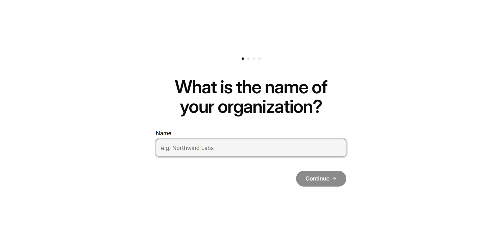

# Backend P1 — COSGRAL Workspace na Windows: od zera do okna

12.11.2026 · Backend Expert · gałąź `team/backend/p1-windows-run` (baza `43f77952d`)

## Następny krok

1. **Lider:** przegląd i scalenie gałęzi (5 commitów, lista niżej). Ok. 15 min.
2. **UI Designer i Tester:** po scaleniu postawcie własną instancję jedną komendą z sekcji 4 (pierwszy raz ok. 10–15 min, potem ok. 1 min).
3. **Właściciel PC (tylko jeśli okno jeszcze wisi):** w monicie Zapory Windows dla `node.exe` kliknij **Anuluj**. Monit wywoływał nasz kod (już naprawione), a dostęp spoza komputera nie jest potrzebny.

## Werdykt

**Działa.** Na tym PC okno Electron samo uruchamia backend (Node + embedded Postgres) na `127.0.0.1` i pokazuje UI. `/api/health` zwraca 200. Zamknięcie okna zatrzymuje Postgresa czysto.

Znalazłem i naprawiłem przyczynę dawnego problemu „Postgres startuje tylko ręcznie”. Sekret JWT agentów jest teraz trwały i zapisany osobno dla każdej instancji. Instalator `.exe` buduje się, ale nie zawiera jeszcze backendu (sekcja 7, zadanie na F5).

| Sprawdzenie | Wynik | Dowód |
|---|---|---|
| `pnpm install --frozen-lockfile` | ✓ 25 min 43 s (pierwszy raz, pusty magazyn pnpm) | log `pnpm-install.log` |
| build `shared` + `plugin-sdk`, `db`, `ui` | ✓ 28 s, 43 s, 87 s | logi `build-*.log` |
| serwer na `127.0.0.1:3110`, Postgres `54340` | ✓ pierwszy start 48 s (initdb 13 s, 425 migracji 15 s) | `GET /api/health` → `200 {"status":"ok","deploymentMode":"local_trusted",…}` |
| Electron sam podnosi backend i pokazuje UI | ✓ okno po 62–79 s | [zrzut](assets/backend-p1-electron-window.png), [log](assets/backend-p1-electron-runs.log) |
| tytuł okna | `COSGRAL Workspace — backend · Paperclip` | log `captured …` |
| zamknięcie okna → czysty stop Postgresa | ✓ 10–12 s, `postmaster.pid` usunięty, 0 procesów `postgres` | sekcja 6 |
| restart po twardym zabiciu | ✓ sierota usunięta automatycznie | log `electron-run2` |
| nasłuch tylko na loopback | ✓ `127.0.0.1:3110`, `127.0.0.1/::1:54340` | `Get-NetTCPConnection` |
| trwały JWT | ✓ ten sam plik `.env` (SHA-256) po 5 restartach, baner `Agent JWT: set` | sekcja 5 |
| testy | ✓ vitest 17/17 (server), node:test 9/9 (app-shell) | sekcja 8 |



## 1. Commity

| Commit | Co |
|---|---|
| `9d02de547` | app-shell: backend per instancja (port z `.paperclip/config.json`), start `node + tsx` zamiast `pnpm.cmd`, uporządkowany stop przez IPC |
| `e76f46298` | server: bezpieczny start i stop embedded Postgres na Windows (sieroty, `pg_ctl stop`, port tylko na loopback) |
| `c1b2523bf` | app-shell: osobne okno i `userData` na instancję, czekanie na stop backendu, zrzut dowodowy, `asarUnpack` |
| `0983202da` | `scripts/cosgral-instance.ps1`: jedna komenda od zera do okna, tryb tła i `stop` |
| (ostatni) | raport + zrzut + wyciąg z logów, `win.signAndEditExecutable: false` dla buildu NSIS |

## 2. Porty i katalogi

| Instancja | Checkout | Port API/UI | Port Postgres | `PAPERCLIP_HOME` | Stan |
|---|---|---|---|---|---|
| backend | `Shared\cosgral-wt\backend` | **3110** | **54340** | `Shared\cosgral-data\backend` | działa, sprawdzone |
| ui | `Shared\cosgral-wt\ui` | 3120 | 54350 | `Shared\cosgral-data\ui` | propozycja |
| tester | `Shared\cosgral-wt\tester` | 3130 | 54360 | `Shared\cosgral-data\tester` | propozycja |
| integracja (lider) | `Shared\cosgral-workspace` | 3100 | 54329 | `Shared\cosgral-data\lead` | propozycja |

`Shared` = `C:\Users\x1 Yoga\OpenBot\Shared`. Wolne porty sprawdziłem 12.11. OpenBot zajmuje 28417 i 56113.

Układ katalogu danych jednej instancji:

```
Shared\cosgral-data\<nazwa>\
  bin\                      pnpm/pnpx (corepack, bez instalacji w systemie)
  logs\                     logi skryptu: server.out.log, electron.out.log, ...
  instances\<nazwa>\db\               klaster Postgres (~100 MB po migracjach)
  instances\<nazwa>\data\storage\     pliki
  instances\<nazwa>\secrets\master.key  klucz szyfrowania sekretów Paperclip
  worktree-port-reservations.json     rejestr portów Paperclip
  server.pid / electron.pid / server.stop   tylko w trakcie pracy w tle
<checkout>\.paperclip\config.json, .env, seed-empty   (git-ignorowane)
%APPDATA%\COSGRAL Workspace\instances\<nazwa>\       userData Electrona, logs\backend.log
```

## 3. Jak to działa (izolacja instancji)

- Działa na wbudowanym mechanizmie worktree w Paperclip. `paperclipai worktree init --empty` zapisuje w checkoucie `.paperclip\config.json` (porty, ścieżki danych) i `.env` (`PAPERCLIP_HOME`, id instancji, sekrety). Serwer uruchomiony w tym checkoucie znajduje config, idąc w górę od katalogu roboczego. Każdy checkout ma więc osobne dane i porty.
- `--empty` tworzy pustą instancję bez kopiowania bazy z innej i z nowymi sekretami. Znacznik `seed-empty` wymusza zapisane klucze, nawet gdy powłoka ma w zmiennych środowiskowych klucze innej instancji.
- Electron (`app-shell/src/backend.js`) czyta port z tego configu, usuwa odziedziczone wskaźniki `PAPERCLIP_*` i uruchamia `node server/node_modules/tsx/dist/cli.mjs app-shell/src/backend-entry.mjs server/src/index.ts`. Bez `pnpm.cmd` i bez `cmd.exe`.
- Każda instancja ma własny katalog `userData`, więc blokada jednej instancji Electrona nie blokuje okna UI ani Testera.

## 4. Procedura „od zera do okna” (UI Designer, Tester)

Wymagania: worktree od lidera, `Shared\tools` (Node 24.22.3, MinGit). Nic nie instalujemy w systemie.

**Jedna komenda (po scaleniu tej gałęzi do Waszej):**

```powershell
cd "C:\Users\x1 Yoga\OpenBot\Shared\cosgral-wt\ui"
powershell -NoProfile -ExecutionPolicy Bypass -File .\scripts\cosgral-instance.ps1 -Name ui -ServerPort 3120 -DbPort 54350
```

Tester: `-Name tester -ServerPort 3130 -DbPort 54360` w `Shared\cosgral-wt\tester`.

Warianty:

```powershell
# Agent albo skrypt: okno w tle, komenda wraca, gdy backend jest zdrowy
... cosgral-instance.ps1 -Name ui -ServerPort 3120 -DbPort 54350 -Background
# Samo API + UI w przeglądarce (http://127.0.0.1:3120), w tle
... cosgral-instance.ps1 -Name ui -Mode server -Background
# Zatrzymanie tego, co ruszyło w tle (czysty stop Postgresa)
... cosgral-instance.ps1 -Name ui -Mode stop
# Zrzut okna jako dowód (PNG treści okna po załadowaniu UI)
$env:COSGRAL_CAPTURE_PATH = "C:\Users\x1 Yoga\OpenBot\Shared\cosgral-data\ui\evidence\okno.png"
```

Porty podajecie tylko przy pierwszym uruchomieniu. Potem skrypt bierze je z `.paperclip\config.json`.

Co robi skrypt (każdy krok pomija, gdy jest już zrobiony):

1. Ustawia `PATH` na portable Node i Git oraz tworzy shimy `pnpm` w `cosgral-data\<nazwa>\bin` (`corepack enable --install-directory`).
2. `pnpm install --frozen-lockfile`. Magazyn pnpm (`%LOCALAPPDATA%\pnpm\store\v3`) jest już wypełniony, więc kolejne checkouty powinny instalować się szybciej (twardymi linkami); tego nie mierzyłem.
3. `pnpm --filter @paperclipai/plugin-sdk build`: jedyny pakiet workspace czytany przez serwer z `dist`; buduje też `shared`.
4. `pnpm paperclipai worktree init --empty --name <n> --instance <n> --home <dane> --server-port <p> --db-port <p>`, a potem wyłącza telemetrię i sprawdzanie aktualizacji w configu instancji.
5. `pnpm --filter @paperclipai/ui build` (Vite, ok. 1,5 min).
6. Uruchamia okno (`app-shell`: `npm ci` i pobranie binarki Electrona, jeśli ich brak) albo samo API.

**Ręcznie, bez skryptu (przed scaleniem):** kroki 1–5 jak wyżej, potem API: `cd server; node node_modules\tsx\dist\cli.mjs src\index.ts` (Ctrl+C zatrzymuje czysto). Okno Electrona z poprawnym portem wymaga zmian z tej gałęzi.

## 5. Trwały sekret JWT — zrobione

- `PAPERCLIP_AGENT_JWT_SECRET` i `PAPERCLIP_TOOL_ACTION_SIGNING_SECRET` (po 32 bajty, base64url) zapisuje `worktree init --empty` w `<checkout>\.paperclip\.env`. Plik jest git-ignorowany, więc nie trafia do repo ani na czat.
- Serwer ładuje je przy każdym starcie. Baner pokazuje `Agent JWT: set`, a SHA-256 pliku `.env` był taki sam przed restartami i po 5 restartach.
- Klucz szyfrowania sekretów Paperclip leży w `instances\<n>\secrets\master.key`, w katalogu danych instancji.
- **Plan na F5 (instalator):** w zainstalowanej aplikacji nie ma checkoutu. Sekrety trzeba wtedy generować przy pierwszym starcie i trzymać przez Electron `safeStorage` (DPAPI) albo w Menedżerze poświadczeń Windows, a serwerowi przekazywać tylko w zmiennych środowiskowych procesu.

## 6. Naprawione blokery Windows (przyczyna → poprawka → dowód)

1. **„Postgres startuje tylko ręcznie”: przyczyna znaleziona i odtworzona.** `embedded-postgres` zatrzymuje klaster przez `taskkill /f /t`. Jeśli postmaster w tej chwili tworzy proces potomny (`--forkchild`), ten potomek przeżywa jako sierota. Trzyma pamięć współdzieloną i odziedziczone gniazdo nasłuchu. Każdy kolejny start kończy się wtedy `FATAL: pre-existing shared memory block is still in use`, a port wygląda na zajęty (serwer przeskakiwał na 54341). Odtworzone w przebiegu `electron-run1` (log).
   - Poprawka A (`server/src/embedded-postgres-orphans.ts`): przed startem na Windows zatrzymuje tylko procesy `postgres`, których rodzicem jest martwy postmaster z `postmaster.pid`, albo procesy `--forkchild` z binarki **tego** checkoutu, których rodzic nie żyje. Żywego postmastera ani innych checkoutów nie dotyka. Gdy Windows ukrywa `ExecutablePath`, używa `CommandLine`. Ścieżkę binarki rozwiązuje przez `realpath`, bo pnpm używa junction.
   - Poprawka B (`server/src/embedded-postgres-windows-stop.ts`): stop przez `pg_ctl stop -m fast -w`, a `taskkill` tylko jako zapas. Dowód: po zamknięciu okna nie ma `postmaster.pid` ani procesów `postgres`.
   - Dowód A: `electron-run2` → `Stopping 1 orphaned embedded PostgreSQL process(es): 4380` → Postgres na 54340 → health 200.
2. **Monit Zapory Windows dla `node.exe`.** Serwer sprawdzał wolny port Postgresa przez `detectPort(54340)` bez hosta. `detect-port` robi wtedy `listen` na wszystkich interfejsach i na `0.0.0.0`. Poprawka: sprawdzanie tylko na `127.0.0.1` (port API już tak robił). Monitu nie da się wywołać ponownie dla tego samego `node.exe`, dopóki stary czeka na decyzję. Poprawkę potwierdza kod `detect-port` (gałąź `hostname`).
3. **Electron zawsze na porcie 3100 i blokada jednej instancji.** Port pochodzi teraz z configu instancji, a `userData` jest osobny dla każdej instancji.
4. **Brak SIGTERM między procesami na Windows.** Zamykanie było twarde, a zabicie `node.exe` zabija też jego Postgresa, bo libuv trzyma procesy potomne w job object z „kill on close”. Teraz `backend-entry.mjs` przyjmuje prośbę o stop przez IPC (Electron) albo przez plik `COSGRAL_STOP_FILE` (skrypt w tle) i wywołuje własne, uporządkowane zamknięcie serwera. Gdy okno Electrona padnie (`disconnect`), serwer też się zamyka, więc nie zostaje osierocony backend.
5. **`pnpm` nie ma w PATH** (jest tylko corepack): shimy przez `corepack enable --install-directory <dane>\bin`, bez zmian w systemie.
6. **npm 11 pomija `postinstall` Electrona** („install scripts not yet covered by allowScripts”), więc binarki brakuje. Pobranie jawnie: `node node_modules\electron\install.js` (skrypt robi to sam).
7. **Build `server` na Windows nie przechodzi** (`mkdir -p`, `cp -R`, a runner wymaga Rust/cargo). Nie jest potrzebny: serwer działa ze źródeł przez `tsx` (shim `server/src/vendor/paperclip-runner`). Z `dist` wystarczy `plugin-sdk`.
8. **`Start-Process -Redirect*` dziedziczy uchwyty**, więc agent, który przechwytuje wyjście, czekał na koniec serwera. Skrypt startuje teraz procesy w tle przez `cmd.exe /d /s /c … > log` bez dziedziczenia uchwytów.

## 7. Instalator `.exe` (`npm run dist:nsis`)

**Zbudowany:** `app-shell\dist-installer\COSGRAL-Workspace-Setup-0.0.1.exe` (93,9 MB, x64, NSIS, niepodpisany, domyślna ikona Electrona) w 147 s. Katalog `dist-installer/` jest git-ignorowany.

- Pierwsza próba padła: electron-builder rozpakowuje `winCodeSign`, a archiwum zawiera dowiązania symboliczne. Bez trybu dewelopera lub praw admina Windows zgłasza „Klient nie ma wymaganych uprawnień”. Obejście bez zmian w systemie: `win.signAndEditExecutable: false` w `app-shell/package.json` (pomija rcedit i podpis; ikonę i metadane exe przywrócimy w F5).
- Smoke spakowanej aplikacji (`dist-installer\win-unpacked\COSGRAL Workspace.exe` z `COSGRAL_REPO` i `COSGRAL_NODE`): health 200 po 95 s, okno `COSGRAL Workspace — backend · Paperclip`, zamknięcie w 2 s z czystym stopem Postgresa. `backend-entry.mjs` z `app.asar.unpacked` działa.
- **Instalatora nie uruchamiałem**, bo instalacja w systemie jest poza zasadami tego zadania.

Nawet zbudowany instalator **nie jest jeszcze samodzielną aplikacją**. `app-shell` pakuje tylko `src/**`, więc backend (repo, `node_modules`, `node.exe`, `ui/dist`) nie jest w środku. Zainstalowane okno działa tylko z `COSGRAL_REPO` wskazującym checkout i z `COSGRAL_NODE`. `backend-entry.mjs` jest już wypakowywany poza `app.asar` (`asarUnpack`). Pakowanie backendu to zadanie F5.

## 8. Testy

```powershell
# server (vitest), z katalogu server/
pnpm exec vitest run src/embedded-postgres-orphans.test.ts src/embedded-postgres-windows-stop.test.ts src/embedded-postgres-owner.test.ts
#  → Test Files 3 passed, Tests 17 passed
# app-shell (node:test), z katalogu repo
node --test app-shell/test/backend.test.cjs
#  → pass 9, fail 0
```

Typecheck: nowe pliki serwera są czyste (`tsc -p` na samych nowych plikach, EXIT 0). Pełny `tsc --noEmit` serwera zgłasza 243 błędy środowiskowe niezwiązane z tą gałęzią: brak typów `@paperclipai/paperclip-runner`, którego build wymaga Rust/cargo (35 × TS2307), i wynikające z tego `implicit any` (181 × TS7006). `src/index.ts` jest bez błędów.

## 9. Czasy (ten PC, 12.11.2026)

| Krok | Czas |
|---|---|
| `pnpm install` (pierwszy, pusty magazyn) | 25 min 43 s |
| `npm ci` app-shell (+ binarka Electrona z cache) | 6 min 19 s |
| `worktree init --empty` | 19 s |
| build `plugin-sdk` + `shared` / `db` / `ui` | 28 s / 43 s / 87 s |
| pierwszy start serwera (initdb + 425 migracji) | 48 s |
| zimny start okna do health 200 (kolejne starty) | 62–117 s (`tsx` transpiluje źródła serwera; 117 s przy równoległym typecheck) |
| zamknięcie okna z czystym stopem Postgresa | 10–12 s |
| stop serwera w tle (`-Mode stop`) | 4 s |
| `electron-builder --win nsis` (z pobraniem NSIS) | 147 s |
| cała praca | ok. 3 h |

## 10. Co nie działa / otwarte

1. **Zimny start 1–2 min.** `tsx` transpiluje cały serwer przy każdym starcie. Lekarstwo: zbudowany `server/dist`, ale to wymaga przeniesienia skryptu `build` z bash na Node i decyzji o binarce runnera (Rust). Zadanie na F5.
2. **Tylko tryb `local_trusted`** (bez kont i logowania). Nie ruszałem; potrzebne przed wspólnymi sesjami (F2).
3. **Dwie instancje obok siebie nie były jeszcze uruchomione razem na tym PC.** Inne worktree to nie mój obszar. Mechanizm (osobne porty, dane, `userData`) jest gotowy; potwierdzi to Tester przy swojej instancji.
4. **Ostrzeżenie upstream** `MaxListenersExceededWarning` (11 listenerów `close`) przy starcie. Nieszkodliwe, nie ruszałem.
5. **Antywirusy na tym PC:** działa Avast, a RAV Endpoint Protection zgłosił „Risk.Powershell.Script.Gen” dla pliku w `AppData\Roaming\OpenBot\…`. To plik OpenBota, nie COSGRAL. Decyzja należy do właściciela; niczego nie klikałem.
6. **Konfiguracja instancji** ma wyłączoną telemetrię i sprawdzanie aktualizacji (decyzja dla prywatnego narzędzia zespołu, odwracalna w `.paperclip\config.json`).

## 11. Co zostało zapisane poza repo

- `Shared\cosgral-data\backend\`: dane instancji, shimy pnpm, logi, dowody (`evidence\`), pliki robocze (`commit-msg.txt`, `debug-orphans.mts`).
- W worktree, ale git-ignorowane: `.paperclip\`, `node_modules\`, `ui\dist\`, `packages\*\dist\`, `app-shell\dist-installer\` (instalator 94 MB).
- `%APPDATA%\COSGRAL Workspace\instances\backend\`: `userData` Electrona.
- Cache użytkownika: `%LOCALAPPDATA%\pnpm\store\v3`, `%LOCALAPPDATA%\electron\Cache`, `%LOCALAPPDATA%\electron-builder\Cache`.
- `worktree init` skopiował przykładowe hooki git (`*.sample`) do `cosgral-workspace\.git\worktrees\backend\hooks`, czyli metadanych tego worktree.
